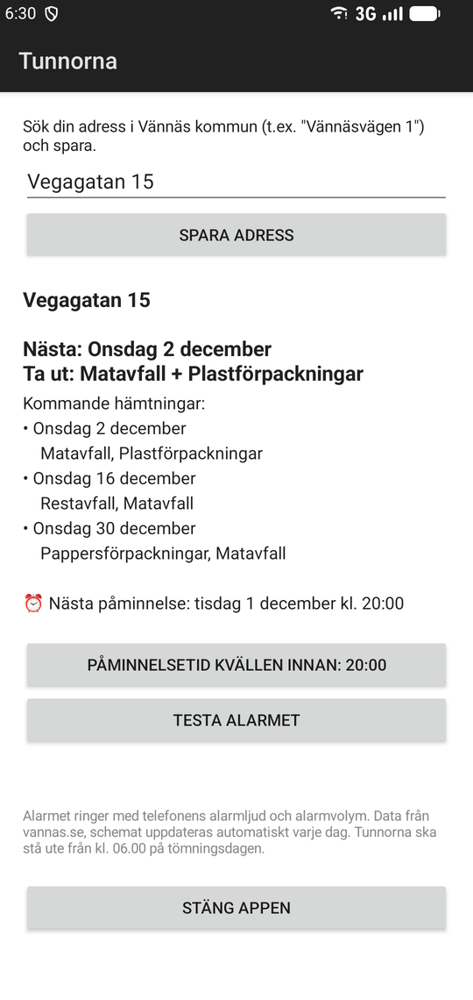
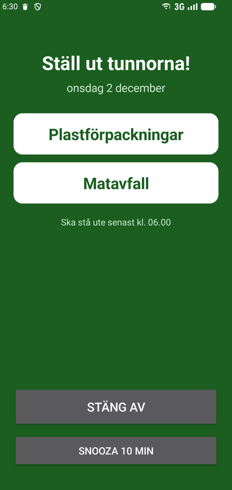

# Tunnorna

Android-app som påminner dig om att ställa ut soptunnorna i **Vännäs kommun**.
Appen hämtar tömningsschemat för din adress från vannas.se och ringer ett alarm
kvällen innan hämtning – med besked om vilka fraktioner som ska ut.

<p>
  
  &nbsp;&nbsp;
  
</p>

## Funktioner

- Sök och spara din adress (med förslag ur kommunens adresslista)
- Lista över kommande hämtningar och vad som ska ställas ut
- Alarm i helskärm kvällen innan, med telefonens alarmljud – även när appen är stängd
- Valfri påminnelsetid och snooza 10 minuter
- Schemat uppdateras automatiskt varje dag

## Installera

1. Ladda ner `Tunnorna.apk` från senaste [releasen](../../releases/latest) på telefonen.
2. Tillåt installation av okända appar för webbläsaren om telefonen frågar.
   Om Play Protect varnar för en okänd app, välj *Installera ändå*.
3. Öppna appen, sök din adress och tryck **Spara adress**.
4. Ge appen behörighet för notiser och helskärmsalarm, och stäng gärna av
   batterioptimering så att påminnelsen inte stoppas.

Kräver Android 8.0 eller senare.

## Bygga själv

Projektet byggs utan Gradle, direkt med Android SDK:s verktyg
(build-tools 36.1.0 och platform android-36):

```sh
./build.sh
```

Utan signeringsnyckel signeras APK:n med debug-nyckeln. GitHub Actions bygger och
signerar automatiskt vid varje push, och en tagg som `v2.2` skapar en ny release.
